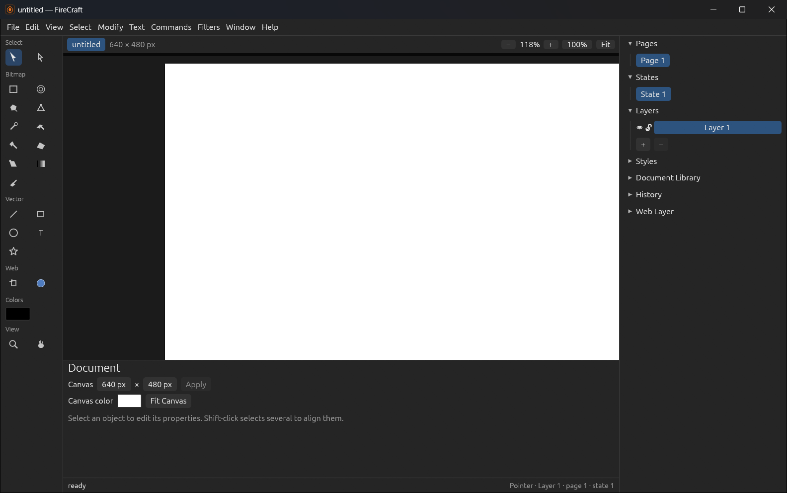
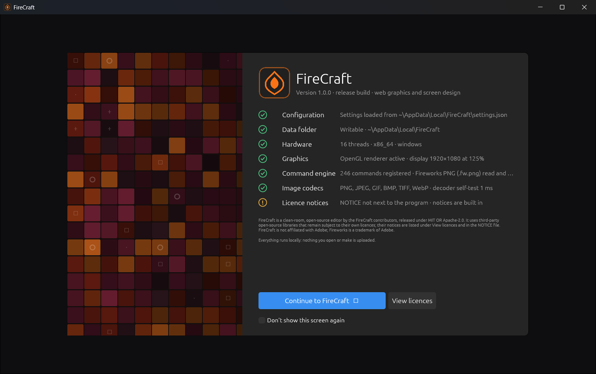

# FireCraft

**Vector and bitmap design for screens and the web, in the spirit of Adobe Fireworks, with a modern
interface.** Draw shapes and paths, paint pixels, slice and export for the web, all in one document.

This is a reworked edition of [aliasfoxkde/FireCraft](https://github.com/aliasfoxkde/FireCraft) (MIT OR
Apache-2.0), an open-source, clean-room reimplementation of Adobe Fireworks CS6 in pure Rust. This edition
adds a redesigned, modern workspace, a startup screen, and fixes across the drawing tools.



## Download

Get the latest version from the [Releases page](https://github.com/VibeCodedSoftware/FireCraft/releases/latest):

| File | What it is |
|---|---|
| `FireCraft-1.0.0-setup.exe` | **Recommended.** Installs for your Windows account (no administrator rights), adds Start menu and desktop shortcuts, and can be removed from *Settings › Apps*. |
| `FireCraft-1.0.0-windows-x64.zip` | Portable. Unzip anywhere and run `firecraft.exe`. `firecraft-cli.exe` is the command-line tool. |

Windows 10 or 11, 64-bit. The program isn't code-signed yet, so Windows SmartScreen may warn the first
time: choose **More info › Run anyway**.

## What changed in this edition

- **A modern workspace:** a new theme, resizable side panels, and a startup screen that checks the
  configuration, hardware, graphics and codecs.
- **Tools that work as you drag:** lines, arrows, circles, the measure and connector lines, the lasso and the
  marquees now show the real shape while you drag instead of an invisible dotted box.
- **Faster painting:** the pencil, brush and eraser no longer lag on large documents.
- **Fixes** to the text tool, the eraser, the polygon marquee, and the pointer and subselection tools.



## Build from source

Needs [Rust](https://rustup.rs/) (stable, MSVC toolchain on Windows).

```sh
cargo build --release -p app -p app-cli      # target/release/firecraft.exe and firecraft-cli.exe
cargo run -p firecraft-cli -- info doc.fw.png # inspect a document
cargo run -p xtask -- ci                      # the full test gate
```

## About the original project

FireCraft replicates Adobe Fireworks CS6, the hybrid vector and bitmap web-design tool Adobe discontinued in
2013: a GPU-accelerated canvas with a deterministic CPU reference renderer, modern codecs, and full read and
write support for Fireworks PNG (`.fw.png`) documents. See the original repository for its WebAssembly build,
roadmap and history. Its planning documents are kept in [`docs/`](docs/), and the attribution and licensing of
vendored material in [`docs/ATTRIBUTION.md`](docs/ATTRIBUTION.md).

> **Trademark notice:** Adobe, Fireworks, Photoshop, Illustrator and Macromedia are trademarks or registered
> trademarks of Adobe Inc. FireCraft is an independent, open-source project and is not affiliated with,
> sponsored by, or endorsed by Adobe Inc.; these names are used only to describe the workflows and file formats
> FireCraft is compatible with.

## License

Dual-licensed under either of the [MIT license](LICENSE-MIT) or the
[Apache License, Version 2.0](LICENSE-APACHE), at your option, as the original project is. See [NOTICE](NOTICE).
